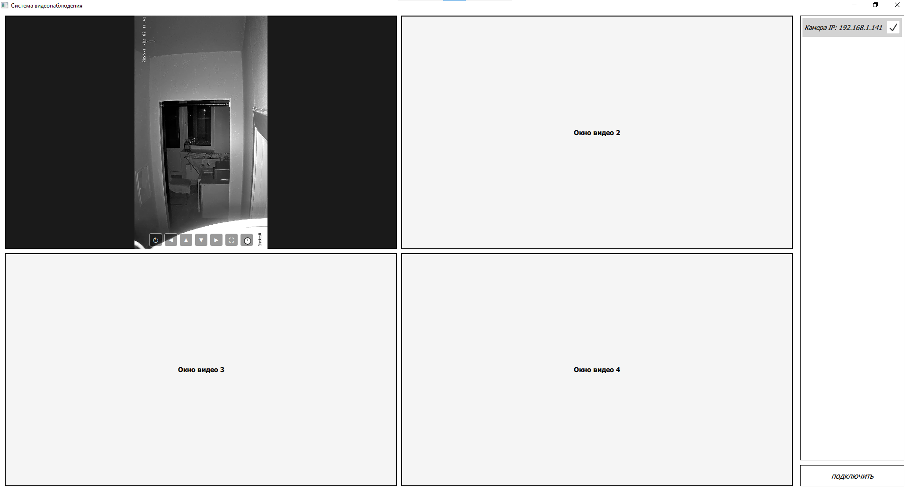
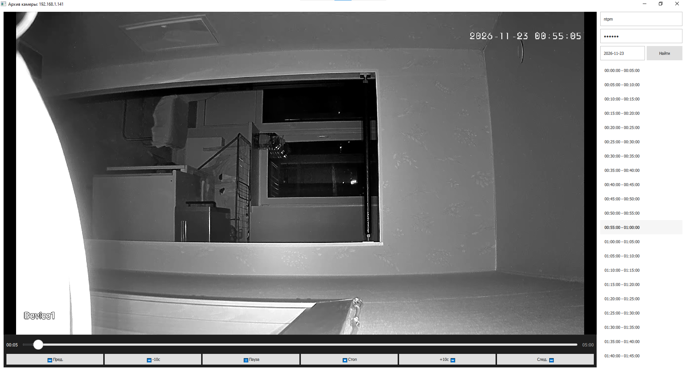

# Система видеонаблюдения (Qt / QML + LibVLC)

Десктопное приложение для IP-видеонаблюдения на **C++23 / Qt 6 (QML)** с поддержкой протоколов **ONVIF** и **DVRIP (XiongMai / Sofia)**, аппаратно-независимым рендерингом потоков через **LibVLC** и просмотром архива с SD-карты камеры.

---

## Скриншоты

| Главный экран (сетка 2×2 и PTZ) | Просмотр архива с таймлайном |
| :---: | :---: |
|  |  |

---

## Основные возможности

* **Автопоиск камер в локальной сети** — обнаружение устройств по протоколу ONVIF WS-Discovery (`239.255.255.250:3702`).
* **Мультиэкранный просмотр** — одновременный вывод до 4 RTSP-потоков (H.264 / H.265) в сетке `2×2` с возможностью развернуть любую камеру на весь экран.
* **Поворот изображения** — вращение видеопотока на `0° / 90° / 180° / 270°` для каждой камеры с сохранением угла.
* **Управление PTZ (ONVIF)** — поворот и наклон камеры, автосохранение текущей позиции в пресет камеры (`SetPreset`) и возврат в неё при переподключении (`GotoPreset`).
* **Архив записей (DVRIP / порт 34567)** — поиск видеофайлов на SD-карте камеры по дате, локальный TCP/HTTP-мост для декодирования сырых кадров (`0xFC`/`0xFD`) в LibVLC.
* **Плеер архива с таймлайном** — шкала прогресса, перемотка по ползунку и шагами `-10с / +10с`, пауза, стоп и переключение между записями.
* **Сохранение настроек** — автоматическое хранение логинов, паролей, углов поворота и PTZ-пресетов по IP-адресу камеры в `camera_settings.json`.

---

## Структура проекта

```text
├── main.cpp                      # Точка входа, регистрация QML-типов и контекста
├── main.qml                      # Главное окно: сетка 2×2, список найденных камер, PTZ-панель
├── ArchiveWindow.qml             # Окно просмотра архива с таймлайном и панелью управления
├── resources.qrc                 # Файл ресурсов Qt (упаковка QML-файлов)
├── camerascanner.h/.cpp          # Поиск камер в сети (UDP Multicast WS-Discovery)
├── cameramanager.h/.cpp          # Управление пулом активных камер и связью с QML
├── camera.h/.cpp                 # Подключение к камере по ONVIF (GetProfiles, GetStreamUri)
├── onvifptzcontroller.h/.cpp     # Управление PTZ-приводом и пресетами через SOAP
├── archivecontroller.h/.cpp      # Авторизация DVRIP, запрос списка файлов и стрим-мост для VLC
├── vlcvideoitem.h/.cpp           # Кастомный QQuickItem для отрисовки кадров LibVLC в SceneGraph
├── settingsmanager.h/.cpp        # Чтение и запись настроек камер в JSON
├── mainwindow.h/.cpp/.ui         # Шаблон окна QWidgets (не используется в сборке)
└── video_surveillance_system.pro # Файл конфигурации сборки qmake
```

---

## Сборка и запуск

### Требования
* **Qt 6.8.3+** (модули: `core`, `gui`, `qml`, `quick`, `network`, `widgets`)
* **Компилятор**: MinGW-w64 64-bit с поддержкой стандарта **C++23** (проверено на `GCC 16.2.0`)
* **LibVLC SDK** (проверено на версии `3.0.24`)

### Инструкция
1. Скачайте **VLC** (включая папку `sdk` с заголовочными файлами и `.lib`) и распакуйте его, например, в `E:/libraries/vlc-3.0.24`.
2. При необходимости поправьте путь к SDK в файле `video_surveillance_system.pro`:
   ```qmake
   VLC_DIR = E:/libraries/vlc-3.0.24
   ```
3. Откройте `video_surveillance_system.pro` в **Qt Creator**, выберите комплект с поддержкой C++23, выполните **Сборка → Запустить qmake** и соберите проект.
4. При сборке под Windows библиотеки `libvlc.dll`, `libvlccore.dll` и папка `plugins` автоматически копируются в директорию с исполняемым файлом.
